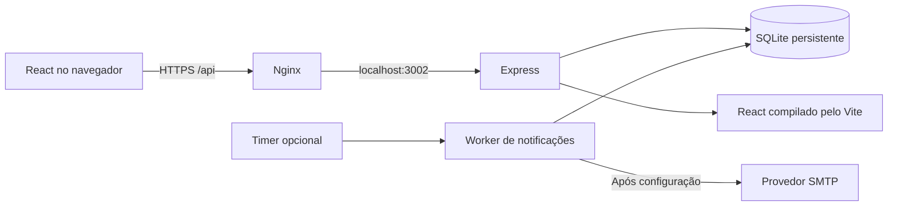

# Agenda de Eventos · !Null

Sistema acadêmico de solicitação, aprovação e consulta de eventos para a **Univille, campus São Bento do Sul**, desenvolvido a partir dos requisitos e referências fornecidos ao grupo **!Null**. A publicação é uma demonstração acadêmica; não representa um serviço institucional autorizado.

- Produção: [flxpfu.com.br](https://flxpfu.com.br/).
- Código público: [felixpfu/univille-eventos](https://github.com/felixpfu/univille-eventos).

## Funcionalidades

| Perfil        | Acesso                                                                                                                           |
| ------------- | -------------------------------------------------------------------------------------------------------------------------------- |
| Visitante     | Agenda dos aprovados do mês atual e dos dois seguintes, sem login. Cadastro opcional para preferências de e-mail.                |
| Solicitante   | Login por e-mail e senha; rascunhos, envio, acompanhamento, edição, correção de rejeitados e cancelamento de pendentes próprios. |
| Administrador | Aprovação/rejeição com prioridade por envio, edição/cancelamento de aprovados, usuários, cadastros e relatórios CSV/PowerPoint.  |

O cadastro começa pela escolha do perfil: visitante informa e-mail e senha; solicitante informa também nome completo, empresa e CNPJ. A empresa e o CNPJ ficam restritos à conta e à administração.

O login é comum aos três perfis e o servidor decide o acesso pela conta. O cadastro público oferece apenas visitante e solicitante. O primeiro administrador é provisionado pela CLI, sem formulário público ou senha padrão; as APIs administrativas também verificam o perfil.

A página inicial destaca o calendário e oferece uma aba em lista, busca e filtros por setor/curso, tema e ambiente. O tema claro é o padrão, com modo escuro opcional e layout para computador e celular. A interface e o PowerPoint utilizam a [marca oficial, com origem documentada](public/branding/SOURCE.md).

As solicitações registram **Realização** como entidade organizadora própria, público em texto e, opcionalmente, curso e semestre do público. O cadastro de curso/coordenação também representa o setor nos filtros; não existe uma entidade separada de setor. O centro de custo é derivado desse cadastro e os recursos devem pertencer ao ambiente.

Pedidos pendentes podem compartilhar horário, mas a aprovação respeita o **primeiro envio** entre os conflitantes. A fila utiliza horário de envio e sequência persistente para desempatar envios no mesmo instante. Reenvio após rejeição ou mudança de data, horário ou ambiente em pedido pendente gera nova posição; correções sem mudar a reserva preservam a posição. A transação de aprovação também impede dois eventos aprovados sobrepostos.

Os relatórios têm atalhos semanal, anual e personalizado, além de filtros combináveis. **CSV** exporta os estados administrativos selecionados; **PowerPoint** contém exclusivamente aprovados, em uma tabela editável com oito colunas, cabeçalho institucional, logo e continuação automática. Veja [PPTX.md](docs/PPTX.md).

Notificações foram implementadas com consentimento, confirmação da propriedade do e-mail, preferências de publicações/lembretes e processamento em segundo plano. **O provedor SMTP ainda não foi configurado, por decisão do responsável.** A interface informa a indisponibilidade, as preferências podem ser salvas e nenhum envio real foi validado. Sem SMTP o timer permanece desativado. Veja [EMAIL.md](docs/EMAIL.md).

## Executar localmente

Requer Node.js **22.13 ou superior**, npm e terminal. A produção usa Node 24 LTS dedicado. O banco utiliza `node:sqlite`, incluído no Node, sem servidor de banco adicional.

```bash
npm ci
cp .env.example .env
npm run build
npm run admin
npm start
```

Abra [http://localhost:3002](http://localhost:3002). `start`, `dev` e `admin` carregam `.env` quando presente. O exemplo define `NODE_ENV=development`, `BASE_PATH=` e `PUBLIC_ORIGIN=http://localhost:3002`. Para usar `http://127.0.0.1:3002`, altere `PUBLIC_ORIGIN` para essa origem exata. A origem inclui protocolo e porta; divergências bloqueiam escritas.

`npm run admin` solicita nome, e-mail e senha com pelo menos 12 caracteres, em prompt que não exibe a senha. Nome e e-mail também podem ser argumentos, mantendo a senha no prompt:

```bash
npm run admin -- --email admin@example.test --name Administracao
```

O banco começa **sem contas, catálogos ou eventos de demonstração**. Cadastre centros de custo e recursos; setores/cursos vinculados a centros; ambientes com recursos; e temas. Depois crie um solicitante pela interface ou administração. A agenda vazia é um estado inicial esperado.

Para acompanhar mudanças do servidor, use `npm run dev`. Após editar React/CSS, execute `npm run build` para atualizar `dist`.

## Arquitetura e persistência



O backend concentra autorização, validações e transações. Senhas usam scrypt com salt; tokens de sessão são aleatórios e persistidos somente como hash. Em produção, cookies usam `HttpOnly`, `Secure`, `SameSite=Strict` e prefixo `__Host-`; escritas verificam a origem. Trocar a senha invalida sessões anteriores.

Os dados ficam em `DATA_DIR/events.sqlite`, por padrão `./data`. Reiniciar ou recompilar não os apaga. A migração **v2** adiciona os novos campos e reconstrói a fila pelo histórico de envio, preservando contas, eventos e auditoria. A migração **v3** adiciona empresa/CNPJ às contas sem alterar dados existentes ou impedir login de contas antigas. Nunca substitua o banco de produção por um banco de desenvolvimento. O diretório pode conter arquivos SQLite `-wal` e `-shm`; use backup consistente com serviço web e worker parados, ou API própria de backup SQLite.

| Diretório                          | Responsabilidade                                                 |
| ---------------------------------- | ---------------------------------------------------------------- |
| `client/`                          | Interface pública, solicitante e administração                   |
| `server/`                          | API, regras, migração, geração de PPTX e fila de e-mail          |
| `public/branding/`                 | Marca institucional e registro da fonte                          |
| `scripts/admin.js`                 | Provisionamento administrativo pela CLI                          |
| `scripts/process-notifications.js` | Processamento opcional da fila SMTP                              |
| `tests/`                           | Integração HTTP/SQLite, notificações simuladas e validação OOXML |
| `deploy/`                          | Pacotes, serviços, Nginx, backups e reversão                     |

## Verificar e publicar

```bash
npm test
npm run build
npm audit --omit=dev
```

A revisão de 23/10/2026 possui **24 testes automatizados**: 12 de backend, sete de notificações, três de PowerPoint e dois de regressão das listagens. A auditoria de dependências é uma verificação separada e deve ser repetida a cada publicação. O [CI](.github/workflows/ci.yml) instala pelo lockfile, testa e compila em pushes e pull requests; ele não contém credenciais e não faz deploy.

O responsável autorizou que **as alterações solicitadas neste projeto sejam versionadas no GitHub e publicadas em flxpfu.com.br** após verificação. A autorização está registrada em [AGENTS.md](AGENTS.md). O procedimento de empacotar, publicar, verificar a versão ativa e reverter está em [DEPLOYMENT.md](docs/DEPLOYMENT.md). O site anterior e os snapshots de atualização são preservados.

Leia também [REQUISITOS.md](docs/REQUISITOS.md) e [VALIDACAO.md](docs/VALIDACAO.md).

## Escopo e autoria

O login utiliza e-mail e senha; não há login institucional, link mágico ou recuperação automática de senha por e-mail. A confirmação de e-mail implementada serve exclusivamente às notificações e não altera o mecanismo de login. Usuários podem trocar a própria senha; redefinições administrativas seguem o procedimento interno.

Inscrições e declarações são indicadores Sim/Não para o setor de Eventos. Não há cadastro de participantes, pagamentos ou emissão de certificados. Use dados fictícios na demonstração. Anexos privados, credenciais, banco operacional, filas e tokens não integram o repositório público.

**Transparência:** ChatGPT/Codex participou da interpretação, implementação, documentação e verificação. A interface usa React e Lucide, o servidor usa Express e Helmet, o PowerPoint usa PptxGenJS, o envio preparado usa Nodemailer e o frontend é compilado pelo Vite. As dependências resolvidas constam em `package-lock.json`. Não foram utilizadas plataformas Lovable ou Bolt. A marca pertence à Univille e seus direitos não são transferidos pela licença do código.
