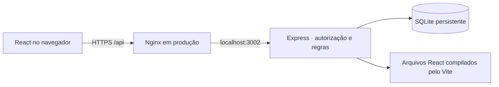

# Agenda de Eventos · !Null

MVP acadêmico para solicitar, aprovar e consultar eventos, desenvolvido a partir do caderno de requisitos fornecido para o desafio da Univille. Este projeto do grupo **!Null** é uma demonstração acadêmica; sua publicação não representa um serviço oficial ou uma vinculação institucional autorizada.

## Funcionalidades

| Perfil        | Acesso                                                                                                                                                |
| ------------- | ----------------------------------------------------------------------------------------------------------------------------------------------------- |
| Visitante     | Agenda pública dos aprovados do mês atual e dos dois seguintes, sem login. Cadastro opcional de visitante não concede permissão de solicitar eventos. |
| Solicitante   | Login por e-mail e senha; rascunhos, envio, acompanhamento, edição, correção de rejeitados e cancelamento de pendentes próprios.                      |
| Administrador | Análise com aprovação/rejeição, edição/cancelamento de aprovados, usuários, cadastros auxiliares e relatórios com CSV.                                |

Há um login comum; o servidor determina o perfil da conta. O cadastro público permite somente visitante e solicitante. A administração aparece apenas para contas autorizadas e suas APIs também verificam o perfil. O primeiro administrador é criado por CLI, sem formulário público e sem senha padrão.

As regras incluem conflito de ambiente/horário, centro de custo derivado do curso, recursos associados ao ambiente, justificativa de rejeição e proteção contra alterações com uma versão antiga do registro. A interface oferece português, modos claro/escuro e layouts para computador e celular.

## Executar localmente

Pré-requisitos: **Node.js 22.13 ou superior**, npm e terminal. Para desenvolvimento e produção, prefira o Node 24 LTS utilizado nesta entrega. O banco usa `node:sqlite`, incluído no Node; não é preciso instalar um servidor de banco.

```bash
npm ci
cp .env.example .env
npm run build
npm run admin
npm start
```

Abra [http://localhost:3002](http://localhost:3002). Os comandos `start`, `dev` e `admin` carregam `.env` se ele existir. O exemplo usa `NODE_ENV=development`, `BASE_PATH=` vazio e `PUBLIC_ORIGIN=http://localhost:3002`. Se acessar pelo endereço `http://127.0.0.1:3002`, altere `PUBLIC_ORIGIN` para essa origem exata, incluindo a porta. Uma origem diferente bloqueia operações de escrita.

`npm run admin` solicita nome, e-mail e uma senha de pelo menos 12 caracteres em um prompt que não a exibe. Use uma conta fictícia no ambiente acadêmico. Também é possível informar apenas nome e e-mail por argumentos, mantendo a senha no prompt:

```bash
npm run admin -- --email admin@example.test --name Administracao
```

O banco começa **sem contas, catálogos ou eventos de demonstração**. Após criar o administrador, entre e cadastre, nesta ordem: centros de custo e recursos; cursos/coordenações vinculados aos centros; ambientes com seus recursos; temas. Em seguida, crie uma conta de solicitante pela interface ou pela administração. Uma agenda vazia é o estado inicial esperado.

Para acompanhar mudanças no servidor, use `npm run dev`. Após editar o React/CSS, execute novamente `npm run build` para atualizar os arquivos servidos em `dist`.

## Arquitetura e dados



O backend concentra autenticação, permissões, validações e transações. Senhas recebem hash scrypt com salt; tokens de sessão aleatórios são guardados no banco somente como hash. Em produção, cookies usam `HttpOnly`, `Secure`, `SameSite=Strict` e prefixo `__Host-`; operações de escrita validam a origem. A troca de senha invalida sessões anteriores.

Os dados persistem em `DATA_DIR/events.sqlite` — por padrão `./data`. Reiniciar ou recompilar não os apaga. O diretório pode conter arquivos SQLite `-wal` e `-shm`; faça backup consistente com o serviço parado ou usando uma API de backup SQLite. `.env`, dados locais, dependências e builds não fazem parte do versionamento.

| Diretório          | Responsabilidade                                     |
| ------------------ | ---------------------------------------------------- |
| `client/`          | Interface pública, solicitante e administração       |
| `server/`          | API, autenticação, banco e regras de negócio         |
| `scripts/admin.js` | Provisionamento administrativo interno               |
| `tests/`           | Testes de integração com banco e servidor HTTP reais |
| `deploy/`          | Build de release, serviço, Nginx, backups e reversão |

## Verificar e publicar

```bash
npm test
npm run build
npm audit --omit=dev
```

O [workflow de CI](.github/workflows/ci.yml) instala pelo lockfile, executa os testes e compila em pushes e pull requests. Ele não possui credenciais nem executa publicação automática.

O destino de produção autorizado é a raiz de [flxpfu.com.br](https://flxpfu.com.br), com runtime Node 24 exclusivo, usuário sem privilégios, dados persistentes e HTTPS pelo Nginx. Os arquivos do site anterior são preservados e sua configuração recebe backup. O procedimento de instalar, verificar, publicar e reverter está em [DEPLOYMENT.md](docs/DEPLOYMENT.md).

Leia também a [especificação e os limites do MVP](docs/REQUISITOS.md) e o [registro de validação e roteiro de aceite](docs/VALIDACAO.md).

## Escopo e autoria

O login utiliza **e-mail e senha**. Não há integração com login institucional, SMTP, link mágico, confirmação de propriedade do e-mail ou recuperação automática de senha. Usuários autenticados podem alterar a própria senha; redefinições administrativas usam os procedimentos internos.

Inscrições e declarações são respostas Sim/Não para orientar o setor de Eventos. Esta versão não cadastra participantes, recebe pagamentos ou emite certificados. Utilize somente dados fictícios na demonstração. Fotos dos documentos fornecidos e credenciais reais não integram este repositório.

**Transparência:** o desenvolvimento teve assistência direta de **ChatGPT/Codex**, incluindo interpretação do caderno, implementação, documentação e verificação. As funcionalidades específicas de eventos foram implementadas neste projeto. A interface usa React e ícones genéricos do Lucide; o servidor usa Express e Helmet; Vite compila o frontend e Prettier formata o código. As dependências e suas versões resolvidas estão declaradas em `package.json` e `package-lock.json`. Não foram usadas plataformas Lovable ou Bolt.
