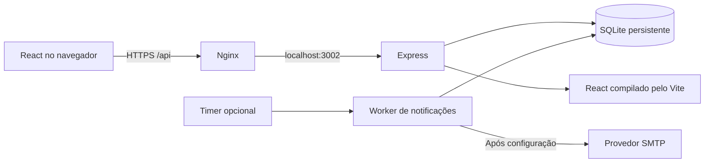

# Agenda de Eventos · !Null

Sistema acadêmico de solicitação, aprovação e consulta de eventos para a **Univille, campus São Bento do Sul**, desenvolvido a partir dos requisitos e referências fornecidos ao grupo **!Null**. A publicação é uma demonstração acadêmica; não representa um serviço institucional autorizado.

- Produção: [flxpfu.com.br](https://flxpfu.com.br/).
- Código público: [felixpfu/univille-eventos](https://github.com/felixpfu/univille-eventos).

## Funcionalidades

| Perfil        | Acesso                                                                                                                              |
| ------------- | ----------------------------------------------------------------------------------------------------------------------------------- |
| Visitante     | Agenda dos aprovados, com consulta de meses passados e futuros, sem login. Cadastro opcional para preferências de e-mail.           |
| Solicitante   | Login por e-mail e senha; rascunhos, envio, acompanhamento, edição, correção de rejeitados e cancelamento de pendentes próprios.    |
| Administrador | Aprovação/rejeição com prioridade por envio, edição/cancelamento de aprovados, usuários, cadastros e relatórios CSV/PowerPoint/PDF. |

O cadastro começa pela escolha do perfil: visitante informa e-mail e senha; solicitante informa também nome completo, empresa e CNPJ. A empresa e o CNPJ ficam restritos à conta e à administração.

O login é comum aos três perfis e o servidor decide o acesso pela conta. O cadastro público oferece apenas visitante e solicitante. O primeiro administrador é provisionado pela CLI, sem formulário público ou senha padrão; as APIs administrativas também verificam o perfil.

A **Gestão de eventos** abre em **Todos os status**, incluindo os aprovados já publicados na agenda. O filtro **Aguardando aprovação** permite consultar apenas a fila pendente. Rascunhos continuam na área do próprio autor.

A página inicial abre na aba **Calendário**. As abas de três meses aparecem tanto no calendário quanto na **Lista**, e o mês selecionado é preservado ao alternar entre essas visualizações. A lista mostra somente o mês selecionado; clicar em um dia da grade abre a lista restrita àquela data. **Ver todos do mês** remove apenas esse recorte por dia, mantendo o mês e os demais filtros. **Limpar filtros** remove busca, setor/curso, tema, local e dia, preservando o mês e a visualização atuais.

A consulta começa no mês atual e nos dois seguintes, mas permite navegar para o passado e o futuro. O botão **+ Próximos três meses** e a seta **Três meses anteriores** mudam o grupo de abas; as setas de mês avançam ou recuam um mês nas duas visualizações. **Mês atual** retorna ao mês da data corrente. Busca e filtros por setor/curso, tema e local do evento continuam disponíveis no calendário e na lista. Navegar para outros meses consulta os registros existentes; não cria eventos.

A API pública aceita `GET /api/events?month=YYYY-MM`: o parâmetro indica o primeiro mês de uma janela de três meses, entre `1900-01` e `9999-10`. Sem o parâmetro, usa o mês atual de São Paulo e os dois seguintes. Todas as janelas retornam exclusivamente eventos aprovados e os campos públicos permitidos. A interface permite selecionar até dezembro de 9999 dentro da última janela válida.

O tema claro é o padrão, com modo escuro opcional e layout para computador e celular. A interface e o PowerPoint utilizam a [marca oficial, com origem documentada](public/branding/SOURCE.md).

Em **Espaços**, os cards exibem imagem, descrição e capacidade máxima quando informada. O responsável informou, em **23/10/2026**, **300 pessoas no Auditório** e **120 no Miniauditório**. O Auditório utiliza uma fotografia publicada pela Univille em 2023; o Miniauditório e a imagem automática de sala usam ilustrações geradas por IA, identificadas na interface. Créditos e origem estão em [public/venues/SOURCE.md](public/venues/SOURCE.md).

Clicar na imagem, no nome ou em **Ver agenda deste espaço** abre a Lista com o local pré-selecionado, permitindo consultar seus eventos futuros e passados pela navegação mensal. O seletor de local é editável. Desde a **v1.7.2**, **Limpar filtros** também remove esse local, mesmo quando a agenda foi aberta por um espaço, sem mudar o mês ou a visualização; **Eventos** retorna à agenda geral. **Solicitar um evento** nesse card abre o formulário com o local preenchido; se for necessário entrar na conta, a seleção é mantida após o login de solicitante ou administrador. A administração edita capacidade e imagem em **Cadastros → Ambientes**, escolhendo imagens do catálogo local. Detalhes em [ESPACOS.md](docs/ESPACOS.md).

Os eventos aprovados têm descrição pública opcional e detalhes de participação por curso e semestres. A descrição é um campo explícito: objetivo, justificativa e observações continuam internos. O botão **Ver detalhes** reúne essas informações para visitantes.

**Sair da conta, cancelar um evento, excluir um rascunho ou cadastro, rejeitar uma solicitação, desativar uma conta e reduzir seu acesso** pedem confirmação com opção de **Voltar**. Os botões dessas ações usam fundo vermelho e texto branco. **Aprovar/publicar** também pede confirmação, com ação positiva verde. Durante a execução, a interface informa o andamento e impede envios repetidos; ao terminar, apresenta sucesso ou erro. Salvamentos comuns mantêm o indicador de andamento e a mensagem de resultado, sem uma confirmação adicional.

As solicitações registram **Realização** como entidade organizadora própria, público em texto e, opcionalmente, curso e semestre do público. O cadastro de curso/coordenação também representa o setor nos filtros; não existe uma entidade separada de setor. O centro de custo é derivado desse cadastro e os recursos devem pertencer ao ambiente.

Pedidos pendentes podem compartilhar horário, mas a aprovação respeita o **primeiro envio** entre os conflitantes. A fila utiliza horário de envio e sequência persistente para desempatar envios no mesmo instante. Reenvio após rejeição ou mudança de data, horário ou ambiente em pedido pendente gera nova posição; correções sem mudar a reserva preservam a posição. A transação de aprovação também impede dois eventos aprovados sobrepostos.

Nos relatórios, escolha diretamente **Data inicial** e **Data final**, ajuste os filtros e pressione **Aplicar filtros**. Não há um campo adicional para escolher um dia da semana. As opções **Semana atual** e **Anual · ano completo** preenchem as datas do formulário; datas editadas diretamente formam um período personalizado. O botão **Semana atual** restaura e aplica a semana corrente no fuso de São Paulo. **Excel / CSV** exporta os estados administrativos selecionados, com quinze colunas, separador `;` e BOM UTF-8 para Excel pt-BR. **PowerPoint** contém exclusivamente aprovados, em uma tabela editável com oito colunas, cabeçalho institucional, logo e continuação automática. **PDF** usa os mesmos aprovados e filtros, em A4 paisagem com texto selecionável, fontes incorporadas e paginação. Veja [CSV.md](docs/CSV.md), [PPTX.md](docs/PPTX.md) e [PDF.md](docs/PDF.md).

Notificações foram implementadas com consentimento, confirmação da propriedade do e-mail, preferências de publicações/lembretes e processamento em segundo plano. **O provedor SMTP ainda não foi configurado, por decisão do responsável.** A interface informa a indisponibilidade, as preferências podem ser salvas e nenhum envio real foi validado. Sem SMTP o timer permanece desativado. Veja [EMAIL.md](docs/EMAIL.md).

## Executar localmente

Requer Node.js **22.13 ou superior**, npm e terminal. A produção usa Node 24 LTS dedicado. O banco utiliza `node:sqlite`, incluído no Node, sem servidor de banco adicional.

```bash
npm ci
cp .env.example .env
npm run build
npm run admin
npm start
```

Abra [http://localhost:3002](http://localhost:3002). `start`, `dev` e `admin` carregam `.env` quando presente. O exemplo define `NODE_ENV=development`, `BASE_PATH=` e `PUBLIC_ORIGIN=http://localhost:3002`. Para usar `http://127.0.0.1:3002`, altere `PUBLIC_ORIGIN` para essa origem exata. A origem inclui protocolo e porta; divergências bloqueiam escritas.

`npm run admin` solicita nome, e-mail e senha com pelo menos 12 caracteres, em prompt que não exibe a senha. Nome e e-mail também podem ser argumentos, mantendo a senha no prompt:

```bash
npm run admin -- --email admin@example.test --name Administracao
```

O banco começa **sem contas, catálogos ou eventos de demonstração**. Cadastre centros de custo e recursos; setores/cursos vinculados a centros; ambientes com recursos; e temas. Depois crie um solicitante pela interface ou administração. A agenda vazia é um estado inicial esperado.

Para acompanhar mudanças do servidor, use `npm run dev`. Após editar React/CSS, execute `npm run build` para atualizar `dist`.

## Arquitetura e persistência



O backend concentra autorização, validações e transações. Senhas usam scrypt com salt; tokens de sessão são aleatórios e persistidos somente como hash. Em produção, cookies usam `HttpOnly`, `Secure`, `SameSite=Strict` e prefixo `__Host-`; escritas verificam a origem. Trocar a senha invalida sessões anteriores.

Os dados ficam em `DATA_DIR/events.sqlite`, por padrão `./data`. Reiniciar ou recompilar não os apaga. A migração **v2** adiciona os novos campos e reconstrói a fila pelo histórico de envio, preservando contas, eventos e auditoria. A migração **v3** adiciona empresa/CNPJ às contas sem alterar dados existentes ou impedir login de contas antigas. A **v4** adiciona a descrição pública vazia, sem copiar textos internos. A **v5** acrescenta capacidade e chave de imagem aos espaços, inicialmente sem preenchimento, preservando contas, eventos, versões, catálogos e vínculos. Nunca substitua o banco de produção por um banco de desenvolvimento. O diretório pode conter arquivos SQLite `-wal` e `-shm`; use backup consistente com serviço web e worker parados, ou API própria de backup SQLite.

| Diretório                          | Responsabilidade                                                 |
| ---------------------------------- | ---------------------------------------------------------------- |
| `client/`                          | Interface pública, solicitante e administração                   |
| `server/`                          | API, regras, migração, geração de PPTX/PDF e fila de e-mail      |
| `public/branding/`                 | Marca institucional e registro da fonte                          |
| `public/fonts/`                    | Fontes Noto Sans e licença para incorporação no PDF              |
| `public/venues/`                   | Fotografias e ilustrações dos espaços, com origem documentada    |
| `scripts/admin.js`                 | Provisionamento administrativo pela CLI                          |
| `scripts/process-notifications.js` | Processamento opcional da fila SMTP                              |
| `tests/`                           | Integração HTTP/SQLite, notificações simuladas e validação OOXML |
| `deploy/`                          | Pacotes, serviços, Nginx, backups e reversão                     |

## Verificar e publicar

```bash
npm test
npm run build
npm audit --omit=dev
```

A suíte da revisão **v1.7.0** contém **60 testes automatizados**: os 54 casos anteriores e seis de espaços. A execução local registrou 60 aprovados, build aprovado e auditoria das dependências de produção com zero vulnerabilidades conhecidas. Os novos casos cobrem migração v4 → v5 sem perda de dados ou versões, base vazia, metadados públicos, permissões administrativas, edição com campos omitidos e limpeza explícita, capacidade inteira e seleção de imagens locais. A auditoria é uma verificação separada e deve ser repetida a cada publicação. O [CI](.github/workflows/ci.yml) instala pelo lockfile, testa e compila em pushes e pull requests; ele não contém credenciais e não faz deploy.

Os roteiros de [espaços](docs/VALIDACAO.md#aceite-dos-espaços--v170), navegação entre meses, calendário/lista e confirmações de ações estão em [VALIDACAO.md](docs/VALIDACAO.md). Resultados de testes, navegador e publicação devem ser registrados nesse documento depois de executados.

O responsável autorizou que **as alterações solicitadas neste projeto sejam versionadas no GitHub e publicadas em flxpfu.com.br** após verificação. A autorização está registrada em [AGENTS.md](AGENTS.md). O procedimento de empacotar, publicar, verificar a versão ativa e reverter está em [DEPLOYMENT.md](docs/DEPLOYMENT.md). O site anterior e os snapshots de atualização são preservados.

Leia também [REQUISITOS.md](docs/REQUISITOS.md) e [VALIDACAO.md](docs/VALIDACAO.md).

## Escopo e autoria

O login utiliza e-mail e senha; não há login institucional, link mágico ou recuperação automática de senha por e-mail. A confirmação de e-mail implementada serve exclusivamente às notificações e não altera o mecanismo de login. Usuários podem trocar a própria senha; redefinições administrativas seguem o procedimento interno.

Inscrições e declarações são indicadores Sim/Não para o setor de Eventos. Não há cadastro de participantes, pagamentos ou emissão de certificados. Use dados fictícios na demonstração. Anexos privados, credenciais, banco operacional, filas e tokens não integram o repositório público.

**Transparência:** ChatGPT/Codex participou da interpretação, implementação, documentação e verificação. A interface usa React e Lucide, o servidor usa Express e Helmet, o PowerPoint usa PptxGenJS com normalização OOXML via JSZip, o PDF usa PDFKit, o envio preparado usa Nodemailer e o frontend é compilado pelo Vite. As dependências resolvidas constam em `package-lock.json`. Não foram utilizadas plataformas Lovable ou Bolt. A marca pertence à Univille e seus direitos não são transferidos pela licença do código.

## Exemplos de eventos

A carga opcional e explícita de oito eventos de exemplo, com horários, descrições, cursos e semestres variados, está documentada em [DEMONSTRACAO.md](docs/DEMONSTRACAO.md). A atualização de [conteúdo para apresentação](docs/APRESENTACAO.md) dá aos exemplos linguagem institucional, sem os rótulos de demonstração na agenda, mantendo sua origem documentada e as observações internas. Os scripts usam a API autenticada e preservam registros alheios ao plano; migrações e inicialização não executam essas operações. O conteúdo preparado não representa programação oficial verificada.

Os locais **Auditório** e **Miniauditório**, informados pelo responsável, aparecem primeiro nas opções de **Local do evento**. Suas capacidades de 300 e 120 pessoas também foram informadas pelo responsável em 23/10/2026; a imagem não é usada para inferir lotação ou equipamentos. O procedimento histórico para atualizar os locais dos exemplos está em [DEMONSTRACAO.md](docs/DEMONSTRACAO.md).

## Acessos para apresentação

As contas de demonstração representam os três perfis: **visitante**, para consultar a agenda e as preferências de notificações; **solicitante**, para demonstrar solicitações; e **administrador**, para aprovar pedidos, gerenciar cadastros e emitir relatórios. Seus dados permanecem no banco SQLite entre reinicializações.

Abra [flxpfu.com.br](https://flxpfu.com.br/) e clique em **Entrar** com o e-mail e a senha do perfil desejado. Para trocar de perfil, use **Sair** e entre com a outra conta. Uma janela privada separa a sessão da janela comum; para demonstrar os três perfis simultaneamente, use navegadores ou perfis de navegador distintos.

O sistema aceita senhas de **12 a 128 caracteres**, inclusive senhas de exatamente 12 caracteres. Os acessos são entregues ao responsável em conversa privada ou arquivo protegido; o README público não contém credenciais. Trocar a senha encerra as sessões anteriores da conta.
