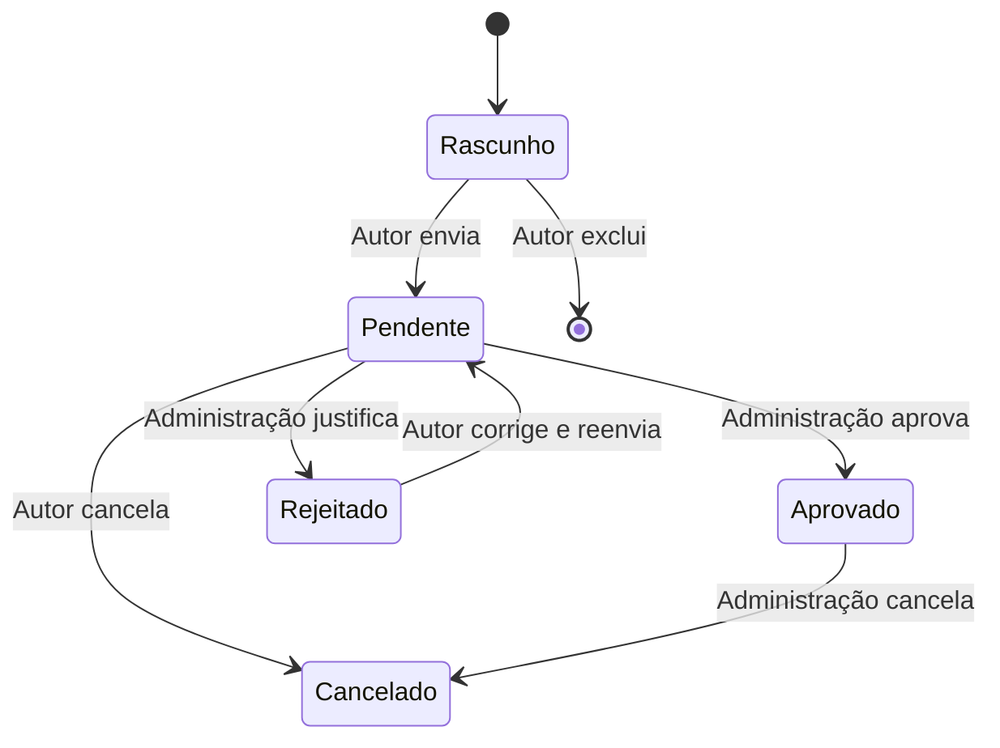

# Requisitos do MVP

Base: caderno do desafio acadêmico fornecido pelo responsável, complementado pelas decisões diretas de implantação e autenticação. Os anexos originais permanecem fora do repositório público. Este texto registra o comportamento implementado e os limites exigidos, sem presumir conteúdo de conversas externas não fornecidas.

## Perfis

| Perfil        | Permissões                                                                                         |
| ------------- | -------------------------------------------------------------------------------------------------- |
| Visitante     | Consultar eventos públicos aprovados, sem autenticação; nenhuma alteração de registros.            |
| Solicitante   | Criar, salvar, enviar, consultar e alterar solicitações próprias conforme o estado.                |
| Administrador | Manter cadastros e usuários, analisar solicitações, editar/cancelar aprovados e emitir relatórios. |

O setor de Eventos representa o cliente/validador e opera por contas administrativas; não constitui um quarto perfil. Autor autenticado e nome livre do solicitante são campos diferentes. Autorização é aplicada na API, incluindo propriedade dos registros. O login usa e-mail único e senha com hash; contas desativadas não autenticam e suas sessões deixam de conceder acesso.

Por decisão do responsável, existe cadastro público opcional de visitante e solicitante. Criar administrador por esse cadastro é proibido; o provisionamento inicial ocorre por CLI e contas administrativas posteriores exigem uma sessão administrativa autorizada.

## Agenda pública

São publicados somente eventos aprovados do **mês atual e dos dois meses seguintes**, considerando `America/Sao_Paulo`, em ordem cronológica. Não se trata de uma janela móvel de 90 dias.

A grade apresenta data, nome, tema, horário inicial/final, local e palestrante. Rascunhos, pendentes, rejeitados e cancelados não são expostos. Informações internas, como justificativa, autor e nome livre do solicitante, não integram a resposta da API pública. Busca, filtros e calendário são conveniências adicionais da interface, não requisitos mínimos do caderno.

## Solicitação

| Grupo                          | Campos                                                                                                                                      |
| ------------------------------ | ------------------------------------------------------------------------------------------------------------------------------------------- |
| Obrigatórios no envio          | Nome, tema, data, início, fim, ambiente, curso/coordenação, solicitante em texto livre, palestrante, público-alvo, justificativa e objetivo |
| Respostas obrigatórias Sim/Não | Cerimonial, haverá inscrições, necessidade de declarações                                                                                   |
| Automático                     | Centro de custo derivado do curso/coordenação                                                                                               |
| Opcionais                      | Recursos necessários e observações                                                                                                          |

Um rascunho pode estar incompleto. No envio, todos os obrigatórios devem estar preenchidos. O evento ocupa um único ambiente em um único dia; aceita data atual ou futura, sem antecedência mínima, e horários entre `00:00` e `23:59`, com término posterior ao início. Valores informados precisam ser válidos mesmo quando o registro é um rascunho. Recursos selecionados devem pertencer ao ambiente escolhido; todos os ambientes cadastrados permanecem selecionáveis.

## Estados e ações



| Estado               | Ações permitidas                                                    |
| -------------------- | ------------------------------------------------------------------- |
| Rascunho             | Autor consulta, edita, exclui ou envia.                             |
| Aguardando aprovação | Autor consulta, edita ou cancela; administração aprova ou rejeita.  |
| Rejeitado            | Motivo obrigatório visível ao autor; autor corrige e reenvia.       |
| Aprovado             | Publicação automática; somente administração edita ou cancela.      |
| Cancelado            | Não aparece na agenda pública; registro enviado permanece no banco. |

“Minhas Solicitações” lista nome, data, local e estado dos registros do usuário, com detalhes e ações correspondentes. Excluir fisicamente é permitido apenas para rascunhos próprios. Uma alteração com versão antiga do registro é recusada para evitar sobrescrever modificações posteriores.

## Conflitos

Envio, aprovação e edição de aprovado revalidam conflitos contra **eventos aprovados**. Há conflito quando ambiente e data coincidem e:

```text
novo.início < existente.fim E novo.fim > existente.início
```

Um aprovado das `19:00` às `20:00` bloqueia `19:30–21:00` no mesmo ambiente; permite `20:00–21:00` e permite o mesmo intervalo em outro ambiente. Pedidos pendentes simultâneos podem coexistir; a aprovação é transacional, de modo que somente um deles seja aprovado quando conflitam. A edição ignora o próprio registro na comparação.

## Administração

Os cadastros incluem centros de custo, cursos/coordenações vinculados a centros, temas, ambientes, recursos e associações ambiente–recurso. Permitem criar e editar; a exclusão é bloqueada quando há vínculos com eventos ou outros cadastros. Remover de um ambiente um recurso já utilizado por evento também é bloqueado.

Usuários possuem nome completo, e-mail único, senha protegida, perfil e situação ativa/inativa. A administração pode cadastrar, editar e desativar; a implementação impede deixar o sistema sem administrador ativo.

As solicitações enviadas podem ser filtradas por estado e abertas para análise. Rejeitar exige justificativa; aprovar executa novamente a validação completa e a checagem de agenda. Administradores podem alterar ou cancelar eventos aprovados, com revalidação quando aplicável.

## Relatórios

Período inicial/final, curso/coordenação e tema funcionam como filtros individuais ou combinados. Os relatórios consideram solicitações já enviadas, incluindo rejeitadas e canceladas, e excluem rascunhos.

Tabela e CSV apresentam os mesmos registros filtrados e os campos: nome, data, início, fim, tema, curso/coordenação, centro de custo, local, solicitante e estado. A exportação trata separadores, aspas, quebras de linha e conteúdo que poderia virar fórmula em planilhas.

## Condições técnicas e entrega

- Aplicação web funcional, com persistência real em SQLite e execução local ou hospedada.
- Interface em português, três perfis, sessão segura e autorização no servidor; nenhuma senha administrativa padrão.
- Repositório público para atualizações, sem fotos privadas, banco operacional, `.env`, tokens ou chaves.
- Implantação na raiz de `flxpfu.com.br`, com HTTPS e possibilidade de reverter a configuração do site anterior.
- Somente dados fictícios na demonstração; banco inicial sem contas, catálogos ou eventos pré-carregados.
- Assistência de IA e reutilização de bibliotecas declaradas no README. Sem Lovable/Bolt ou cópia de código de equipes concorrentes.

Login institucional, autocadastro, recuperação por e-mail, gestão de participantes e emissão de declarações não são obrigatórios pelo caderno. O autocadastro foi incluído por decisão do responsável. Inscrições e declarações permanecem somente indicadores Sim/Não; envio de e-mail e recuperação automática de senha não fazem parte desta versão.
