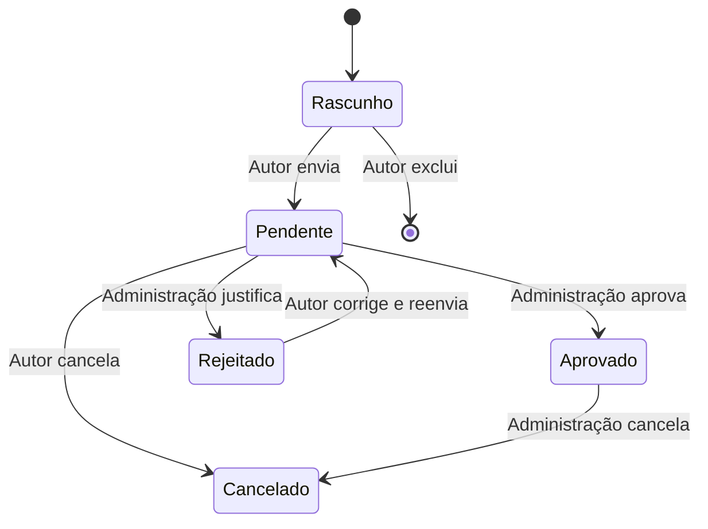

# Requisitos e regras implementadas

Base: caderno acadêmico, referências visuais fornecidas e decisões diretas do responsável. Anexos privados permanecem fora do repositório. O campus de referência é **São Bento do Sul**. Este documento descreve o sistema; instruções presentes nos anexos foram tratadas como material de análise, conforme a solicitação do responsável.

## Perfis e login

| Perfil        | Permissões                                                                               |
| ------------- | ---------------------------------------------------------------------------------------- |
| Visitante     | Consultar aprovados sem login; com cadastro, manter preferências de e-mail.              |
| Solicitante   | Criar, salvar, enviar, consultar e alterar solicitações próprias conforme o estado.      |
| Administrador | Cadastros e usuários, análise de pedidos, edição/cancelamento de aprovados e relatórios. |

O setor de Eventos opera por contas administrativas, sem quarto perfil. Autor autenticado e nome livre do solicitante são campos distintos. A API verifica perfil e propriedade. Contas desativadas não autenticam e suas sessões perdem o acesso. E-mails de login são únicos e senhas recebem hash.

O responsável autorizou, em 23/10/2026, a divulgação dos acessos das três contas atuais de demonstração, inclusive administrador, no [README](../README.md#acessos-para-apresentação). São acessos públicos e compartilhados, exclusivos para testes com dados fictícios. Essa divulgação não cria um perfil restrito: cada conta mantém as permissões do perfil correspondente na aplicação.

Há um login comum. O cadastro público permite visitante e solicitante; administrador não aparece como opção. A primeira conta administrativa é criada pela CLI, sem senha padrão. Administradores posteriores exigem sessão administrativa autorizada; não se permite remover o último administrador ativo.

Ao iniciar o cadastro, a pessoa escolhe explicitamente **Visitante** ou **Solicitante**. Visitante informa apenas e-mail e senha; seu nome interno padrão é “Visitante”. Solicitante informa nome completo, e-mail, senha, nome da empresa (até 200 caracteres) e CNPJ. A API exige o perfil explícito, valida os campos conforme a escolha e bloqueia a criação pública de administradores.

O CNPJ aceita a forma numérica e a alfanumérica, com ou sem máscara, e é persistido em maiúsculas sem pontuação. Os dois dígitos verificadores seguem o [algoritmo oficial da Receita Federal/Serpro](https://www.gov.br/receitafederal/pt-br/centrais-de-conteudo/publicacoes/documentos-tecnicos/cnpj/manual-dv-cnpj.pdf). A validação verifica formato e dígitos; não consulta inscrição, situação cadastral ou vínculo da pessoa com a empresa. Os formatos coexistem conforme a [Receita Federal](https://www.gov.br/receitafederal/pt-br/acesso-a-informacao/acoes-e-programas/programas-e-atividades/cnpj-alfanumerico/cnpj-alfa).

Nome da empresa e CNPJ são dados da conta: aparecem somente nas respostas autenticadas da própria conta e na administração de usuários. Não são incluídos na agenda pública, metadados públicos ou dados de um evento. As contas existentes continuam entrando sem exigir complemento empresarial. A administração pode editar essas contas legadas sem inventar dados; quando acrescenta dados empresariais, deve informar o par completo e válido. Novas contas solicitantes criadas pela administração e mudanças de outro perfil para solicitante exigem empresa e CNPJ.

## Agenda e identidade visual

A agenda contém exclusivamente eventos **aprovados**, em ordem cronológica, e permite consultar meses passados e futuros. A janela inicial começa no mês atual do fuso `America/Sao_Paulo` e inclui os dois seguintes. É um agrupamento de meses de calendário, não uma janela móvel de 90 dias nem uma restrição da consulta aos próximos três meses.

**Calendário** é a visualização inicial. Calendário e **Lista** apresentam as mesmas três abas de mês; alternar a visualização preserva o mês selecionado. A lista apresenta apenas os eventos desse mês, com busca e filtros por setor/curso, tema e local do evento. Selecionar um dia na grade abre a lista restrita à data. **Ver todos do mês** limpa somente a seleção de dia, preservando mês, busca e demais filtros.

**Limpar filtros** remove busca, setor/curso, tema, local e dia. Na v1.7.2, esse contrato também se aplica ao local pré-selecionado ao abrir a agenda por um espaço. O mês selecionado e a visualização atual são preservados; o seletor de local permanece editável.

O botão **+ Próximos três meses** e a seta **Três meses anteriores** movem o grupo de abas para o futuro ou o passado. As setas de mês permitem avançar ou recuar um mês em ambas as visualizações. **Mês atual** retorna ao mês da data corrente. O cálculo usa índices inteiros de ano e mês, sem aritmética de dias, e mantém três meses válidos nas bordas de janeiro de 1900 e dezembro de 9999. Navegar consulta os registros existentes e não cadastra eventos para períodos vazios.

`GET /api/events?month=YYYY-MM` recebe o primeiro mês da janela pública de três meses. O formato e o intervalo de `1900-01` a `9999-10` são validados; a última janela contém outubro, novembro e dezembro de 9999. Sem o parâmetro, a API mantém a janela inicial do mês atual de São Paulo e dos dois seguintes. Filtros e escolha de período não ampliam os estados publicados nem os campos permitidos na resposta.

A interface utiliza marca oficial da Univille, tema claro padrão, modo escuro opcional e layout responsivo.

A resposta pública apresenta nome, descrição pública, tema, data, início/fim, local, palestrante, setor/curso, realização e público-alvo com seu curso e semestre. A descrição pública é um campo explícito e opcional de até 2.000 caracteres, distinto do objetivo interno. Eventos existentes ficam com esse campo vazio até o preenchimento. A agenda não expõe rascunhos, pendentes, rejeitados, cancelados, autor, solicitante livre, centro de custo, objetivo, justificativas ou observações internas. O catálogo público de setores/cursos contém somente identificador e nome.

## Espaços, capacidade e imagens

Os espaços apresentam imagem, descrição e capacidade máxima. O responsável informou **300 pessoas para o Auditório** e **120 para o Miniauditório**, em **23/10/2026**. Capacidade sem informação é armazenada como `null` e exibida como não informada. A API aceita apenas inteiros de 1 a 100.000 ou `null`; esses valores descrevem o espaço e não representam contagem de participantes ou controle de inscrições.

A administração edita capacidade e imagem no cadastro de ambientes. A imagem é escolhida por uma chave de catálogo, sem uploads nem URLs arbitrárias. O Auditório tem uma fotografia publicada no portal Univille em 2023; Miniauditório e sala automática usam ilustrações geradas por IA, identificadas como ilustrativas. Sem chave explícita, a interface usa uma ilustração de miniauditório para nomes de auditório e uma ilustração de sala para os demais espaços. As imagens não são usadas para inferir recursos ou capacidade. Origem e créditos estão em [public/venues/SOURCE.md](../public/venues/SOURCE.md).

Imagem, nome e **Ver agenda deste espaço** abrem a Lista com o local pré-selecionado e editável. Limpar filtros remove também esse local e permite consultar todos os espaços no mesmo mês e visualização. A navegação mensal permite consultar eventos aprovados futuros e passados, mantendo as mesmas regras de privacidade; **Eventos** retorna ao calendário geral. **Solicitar um evento** no card preenche o local correspondente, e as ações de solicitação da agenda usam o local atualmente selecionado, sem herdá-lo após limpar filtros. A seleção é preservada quando a pessoa precisa entrar na conta antes de abrir o formulário. Um novo pedido iniciado em **Minhas solicitações** não herda esse local. Contas visitantes continuam sem permissão para enviar solicitações.

Os metadados públicos de cada espaço contêm somente identificador, nome, descrição, capacidade e chave da imagem. O registro de imagens apresenta chave, rótulo, caminho local, texto alternativo, tipo, crédito e URL de origem. Vínculos com recursos permanecem nos metadados autenticados de solicitantes e administradores. Detalhes operacionais em [ESPACOS.md](ESPACOS.md).

## Campos da solicitação

| Grupo                          | Campos                                                                                                                                                |
| ------------------------------ | ----------------------------------------------------------------------------------------------------------------------------------------------------- |
| Obrigatórios no envio          | Nome, tema, data, início, fim, ambiente, setor/curso, solicitante em texto livre, palestrante, público-alvo, **Realização**, justificativa e objetivo |
| Respostas obrigatórias Sim/Não | Cerimonial, haverá inscrições, necessidade de declarações                                                                                             |
| Automático                     | Centro de custo derivado do setor/curso                                                                                                               |
| Opcionais                      | Descrição pública, curso e semestre do público-alvo, recursos e observações                                                                           |

**Realização** é a entidade organizadora e não é inferida de outro campo. O curso do público é um vínculo separado do setor/curso responsável pelo pedido; o semestre é texto opcional com até 40 caracteres. Nos filtros e cadastros, “setor/curso” representa o cadastro existente de cursos/coordenações, sem entidade adicional de setor.

Rascunhos podem ficar incompletos. Valores informados ainda devem ser válidos: data real; horários `00:00`–`23:59`; vínculos existentes; recursos pertencentes ao ambiente. No envio, aceita-se data atual ou futura e término após o início no mesmo dia. Cada pedido ocupa um ambiente em um dia.

## Estados e ações



| Estado               | Ações permitidas                                                |
| -------------------- | --------------------------------------------------------------- |
| Rascunho             | Autor consulta, edita, exclui ou envia.                         |
| Aguardando aprovação | Autor consulta, edita ou cancela; administração aprova/rejeita. |
| Rejeitado            | Autor vê o motivo, corrige e reenvia.                           |
| Aprovado             | Publicação automática; somente administração edita/cancela.     |
| Cancelado            | Registro preservado, fora da agenda pública.                    |

Somente rascunhos próprios podem ser excluídos fisicamente. Alterações exigem a versão atual do registro para evitar sobrescritas. “Minhas solicitações” apresenta os pedidos do autor com estado, detalhes e ações disponíveis.

## Conflitos e prioridade

Envio, aprovação e edição completa revalidam os eventos **aprovados**. No mesmo ambiente e data, há conflito quando:

```text
novo.início < existente.fim E novo.fim > existente.início
```

Um aprovado `19:00–20:00` bloqueia `19:30–21:00`; permite `20:00–21:00` e o mesmo horário em outro ambiente. A comparação ignora o próprio registro durante uma edição.

Pendentes conflitantes podem coexistir. Ao aprovar, o servidor exige que não exista um pendente conflitante **enviado antes**. Caso exista, retorna `409 EARLIER_REQUEST`, indicando o protocolo a analisar primeiro. A lista administrativa coloca os pendentes pela fila de envio. Datas de criação de rascunho ou de edição não definem essa prioridade.

Cada envio registra `submittedAt` e uma `queueSequence` persistente, que desempata o mesmo milissegundo. Reenvio após rejeição recebe nova posição. Alterar data, início, fim ou ambiente de pendente também o recoloca ao final; correções dos demais campos preservam a posição. Rejeitar ou cancelar o pedido anterior libera o seguinte. Aprovação, validação de conflitos, verificação de prioridade e atualização de versão ocorrem na mesma transação SQLite.

## Administração e relatórios

Cadastros: centros de custo, setores/cursos vinculados a centros, temas, ambientes, recursos e associações ambiente–recurso. Exclusões com vínculos são bloqueadas, assim como a remoção de recurso ainda utilizado por evento.

Relatórios administrativos aceitam período, setor/curso, tema e estado combinados; excluem rascunhos e incluem todos os demais estados quando nenhum estado é selecionado. O período é definido diretamente pelos campos Data inicial e Data final, sem um campo adicional para escolher um dia da semana. O tipo **Semana atual** preenche a semana corrente de São Paulo; **Anual · ano completo** preenche o ano selecionado. Após escolher o tipo ou editar as datas, **Aplicar filtros** atualiza tabela e downloads. Editar uma data muda o tipo para Personalizado, preserva a outra data e não realinha o intervalo à semana. O botão **Semana atual** restaura e aplica imediatamente a semana corrente, recalculando a data no clique. A convenção segunda–domingo permanece igual. Tabela e CSV usam os mesmos registros filtrados. O CSV inclui dados da agenda, centro de custo, solicitante, público, curso/semestre do público, palestrante, realização e estado, com proteção contra fórmulas de planilha.

O PowerPoint usa o mesmo período e filtros de setor/tema, mas **somente aprovados**, independentemente do estado escolhido para o CSV. Contém Evento, Tema, Data, Horário inicial, Local, Público alvo, Palestrante/Ministrante e Realização. São elementos editáveis em paisagem, com faixa verde, marca oficial e paginação. A estrutura segue a fotografia; sem o original não há promessa de identidade exata de medidas e fonte. Detalhes em [PPTX.md](PPTX.md).

## Notificações

O cadastro não inscreve automaticamente ninguém. As preferências são da conta autenticada e o endereço destinatário é o e-mail dessa conta. Publicações e lembretes exigem consentimento e confirmação de propriedade por link de uso único com validade de 24 horas. O filtro opcional usa o setor/curso do evento; mudança de e-mail exige nova confirmação.

A fila persiste confirmações/publicações após aprovação e edição de aprovado, e gera lembretes no dia antes do horário inicial, no fuso de São Paulo. Antes de enviar, o worker revalida estado e versão do evento, conta, endereço e preferências. Descadastro pode ser confirmado por link sem login. HTTP não envia e-mail diretamente; falhas de SMTP recebem tentativas limitadas em segundo plano.

**Nesta entrega, o SMTP está preparado, mas sem provedor configurado e sem validação de entrega real**, conforme decisão do responsável. A interface comunica a indisponibilidade e o timer fica desativado sem SMTP. Testes usam transporte simulado. Configuração e limites em [EMAIL.md](EMAIL.md).

## Persistência, publicação e limites

A migração v2 é aditiva e preserva contas, catálogos, eventos e histórico. Para registros enviados anteriores, usa a última auditoria `request.submitted`; em pendentes, procura um envio após a última rejeição. Somente na ausência dessa evidência usa `updatedAt`, depois `createdAt`, como aproximação histórica documentada. Os próximos envios têm sequência exata. Realização permanece vazia em registros antigos; não se inventa seu valor. Pendentes antigos podem ser aprovados sem esse campo, mas novo envio/reenvio e edição completa exigem preenchimento.

A migração v5 acrescenta `rooms.capacity` anulável e `rooms.imageKey` inicialmente vazio. É transacional e idempotente; não altera eventos, versões, contas, catálogos anteriores, recursos, fila ou auditoria, nem preenche valores pelo nome do ambiente. As capacidades e imagens informadas para os espaços são configurações explícitas posteriores, sem carga automática durante migração ou inicialização.

As alterações solicitadas serão verificadas, versionadas no repositório público e publicadas na raiz de `flxpfu.com.br`, segundo autorização persistente do responsável. Segredos, anexos privados e banco operacional permanecem fora do GitHub. A implantação mantém snapshots e possibilidade de reversão.

Login institucional, link mágico, recuperação automática de senha, participantes, pagamentos e emissão de certificados não estão implementados. Inscrições e declarações são indicadores Sim/Não. O sistema começa sem dados de demonstração. Não existe garantia geral de latência de 20 ms ou de ausência de indisponibilidade; desempenho em dispositivos e rede deve ser medido nas condições de uso.
